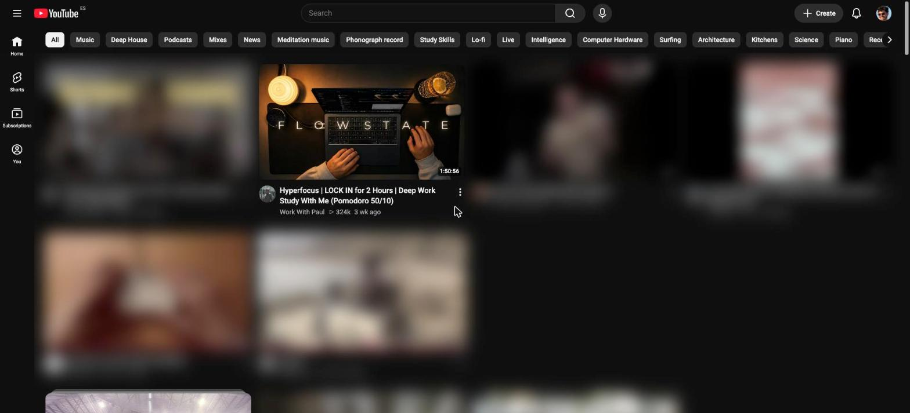

# Tube Focus Mode with Jev

**YouTube, minus the rabbit hole.** A Chrome extension that filters YouTube down to what you're actually there for: your channels, your playlists, and videos on the topics you choose. Everything else gets blurred out.



You open YouTube for one tutorial. Forty minutes later you're watching a stranger restore a rusty knife. The homepage, the recommendations and Shorts are built to make that happen. This extension takes them out of the way, without taking YouTube away.

## What it does

- **Filters the homepage, video by video.** Cards that match your focus stay sharp. The rest blur in place, so the layout never jumps around.
- **Gates every video you open.** Off-topic videos get a "not today" screen and won't play. On-topic ones load as normal, usually in under a second.
- **Blocks Shorts entirely** while focus mode is on, and hides the recommendations sidebar and end screens.
- **Locked work hours.** Set weekly windows (say Mon–Fri, 9:00–18:00) when focus mode turns on by itself and can't be switched off from the popup.

## How it decides

Every video goes through three checks, in order. The first two never leave your browser.

1. **Pinned videos and playlists** you added are always allowed.
2. **Allowed channels** are always allowed. Add them as `@handle` (or paste the channel's link) for an exact match. One saved handle also covers collabs that channel is credited on.
3. **Everything else is asked to [Jev](https://typesafe.ai)** (pinned to `jev-1.14.0`), TypeSafe's classification model: *"Does this video match the topics this person wants to focus on?"* Jev answers with a probability from 0 to 1, and the video is allowed if it's above your threshold (you set it with a slider).

You describe your topics in plain words, like *"Notion tutorials, focus music, lo-fi, programming"*. No keyword lists.

Jev's answers are cached per video, so scrolling back up or reopening a video doesn't ask again. Because the cache stores the score rather than the verdict, moving the threshold slider is free. Only editing your topics clears it.

## What it costs

You bring your own TypeSafe API key, so checks are billed to your TypeSafe account. Jev charges per input token, and output is free. A typical check is around 60–200 tokens, so expect roughly **$0.003–$0.008 per 1,000 videos**, or a fraction of a cent per browsing session (prices checked October 2026).

There's a built-in safety cap of 1,000 checks per day, with a live counter in the popup. Past the cap, videos stay blocked instead of costing more.

## Privacy

- No account, no analytics, no tracking. There's no server of ours involved at all.
- Your settings and API key stay in your browser.
- Topic checks are **off until you allow them**. When on, only the video's title, channel and description (plus your topic text) are sent to TypeSafe.

Full details in [PRIVACY.md](PRIVACY.md).

## Install

It's not on the Chrome Web Store yet, so for now you load it from source. You don't need to be a developer; it takes about two minutes.

You'll need [Node.js](https://nodejs.org) 18 or newer, and a [TypeSafe](https://typesafe.ai) API key.

```bash
git clone https://github.com/OriolSegarra/tube-focus-mode.git
cd tube-focus-mode
npm install
npm run build
```

Then in Chrome (or Arc, Brave, Edge):

1. Go to `chrome://extensions` and switch on **Developer mode** (top right).
2. Click **Load unpacked** and pick the `dist` folder.
3. Pin the extension and open its popup.

### Set it up

1. Paste your TypeSafe API key.
2. Write your focus topics and click **Allow topic checks**.
3. Add any channels you always want (`@handle` or a channel link) and any videos or playlists to pin.
4. Flip the toggle on, or set locked work hours.

After updating the extension, reload it in `chrome://extensions` **and reload your YouTube tabs**. Open tabs keep running the old copy until you do.

## Development

```bash
npm run dev     # dev build with hot reload (load dist/ unpacked while it runs)
npm run build   # type-check + production build into dist/
npm run lint    # ESLint
```

Built with TypeScript (strict), React and Tailwind for the popup, and Vite with [CRXJS](https://crxjs.dev) for the Manifest V3 build.

```
src/
├── background/   service worker: allow/block decisions, Jev calls, spending cap
├── content/      runs on youtube.com: homepage filtering, video overlay, Shorts blocking
├── lib/          shared logic: storage, score cache, TypeSafe client, schedule, types
└── popup/        the settings popup (React)
```

Production builds ship with a strict content security policy (scripts only from the extension, network only to `api.typesafe.ai`) and no debug logging. Need to know why a homepage card was blurred? Inspect it: each one carries a `data-focus-reason` attribute (`channel`, `pinned`, `topic`, `limit`…).

## Known limits

- **It depends on YouTube's page structure.** When YouTube changes its markup, filtering can slow down or miss cards until the selectors are updated. It fails closed: when in doubt, it blocks.
- **Desktop youtube.com only.** Not the mobile site or the apps.
- **Jev is strongest in English.** Jev 1.14 improved other languages, but test with your own feed before relying on it for non-English topics.
- **Homepage cards have no description**, so a card's score is a slightly rougher guess. Opening the video re-checks it with the full description.
- **It's a nudge, not a lock.** Anyone can disable the extension. It's built for people who want help focusing, not for parental control.

## Credits

Built by [Oriol Segarra](https://sintesi.studio) at Síntesi Studio, with Claude Code. Topic checks are powered by [Jev](https://typesafe.ai) from TypeSafe. This project isn't affiliated with or endorsed by YouTube or TypeSafe.

## License

[MIT](LICENSE). Use it, change it, ship your own version; just keep the copyright notice.
